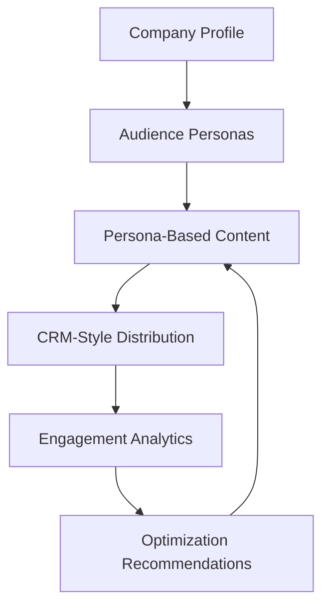
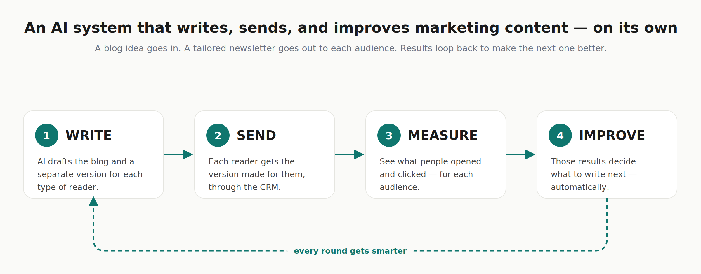

# AI PMM Workflows

A portfolio of AI-native product marketing workflows that show how product marketers can use LLMs, automation, and lightweight systems to improve audience research, content generation, campaign execution, and performance optimization.

This repository is designed as a product marketing portfolio project, not just a code demo. It shows how AI can help structure repeatable GTM workflows from company context to persona-based messaging, CRM-style distribution, measurement, and next-step recommendations.

---

## 🎯 Try the Interview Demo (No Setup)

**Start here if you are reviewing this portfolio.** The [interactive workflow playground](docs/demo.html) lets you select Zip, Shopify, or Datadog and explore audience segmentation, persona-specific content, simulated performance, and optimization decisions without installing anything.

- **For a hosted browser demo:** publish the `docs/` folder with GitHub Pages, then open `https://liwelaine.github.io/ai-pmm-workflows/demo.html`.
- **For a local, offline demo:** download `docs/demo.html` and open it in a browser.
- **For the actual Python pipeline:** follow the CLI or Flask instructions below. The browser demo is a prepared example replay, **not** a live Claude generation, HubSpot send, or real campaign dataset.

---

## Live HubSpot Performance Dashboard (Read Only)

The local Flask app now provides **two clearly separated experiences**:

- [Interactive portfolio prototype](docs/demo.html) — prepared company examples with simulated performance, safe to share on GitHub Pages.
- **Real HubSpot email performance** — run Flask locally and open \`http://127.0.0.1:5000/performance\`. It retrieves real email statistics, rates, time trends, and recent emails directly from HubSpot. A server-side private app token is required; the page shows no fake metrics when unavailable.

See [HubSpot live setup](ai-content-pipeline/HUBSPOT_LIVE_SETUP.md) for the few local setup steps. GitHub Pages does **not** run Python and must never contain a HubSpot token.

---

## Workflow at a Glance


## Preview


---

## Featured Workflow: AI Content Pipeline

AI Content Pipeline is a runnable workflow that takes a company profile as input and turns it into segmented marketing content and performance recommendations.

The workflow moves from company profile to personas, content, CRM-style distribution, analytics, and optimization recommendations.

---

## Why I Built This

I built this to demonstrate how I think about AI-native product marketing: not just using AI to generate copy, but designing a repeatable system that connects segmentation, messaging, content creation, distribution, measurement, and optimization.

The goal is to show PMM judgment, GTM thinking, and AI workflow design in one practical project.

---

## What This Demonstrates

- Audience segmentation
- Messaging and positioning
- Content strategy
- CRM-style campaign execution
- Performance analysis
- AI workflow design
- GTM system thinking
- Turning repeatable marketing processes into scalable systems

---

## Repository Structure

```text
ai-pmm-workflows/
├── ai-content-pipeline/      # Main runnable AI PMM workflow
├── assets/                   # Screenshots and diagrams
├── docs/                     # Portfolio demo page
├── main.py                   # Legacy root runner
├── smoke_test.py             # Legacy root test
└── setup-content-engine.sh   # Setup helper
```

---

## Run Locally

```bash
cd ai-content-pipeline
python main.py run --profile examples/zip.json
```

You can also run another company profile:

```bash
python main.py run --profile examples/shopify.json
python main.py run --profile examples/datadog.json
```

---

## Dashboard

```bash
cd ai-content-pipeline
python dashboard/app.py
```

Then open:

```text
http://127.0.0.1:5000
```

---

## Detailed Documentation

For the full technical workflow, see:

```text
ai-content-pipeline/README.md
```

For the Claude Skill version, see:

```text
ai-content-pipeline/SKILL.md
```

---

## Future Workflow Ideas

- Competitive positioning analyzer
- ICP research generator
- Sales enablement brief builder
- Customer interview synthesis workflow
- Launch messaging and GTM planning assistant
